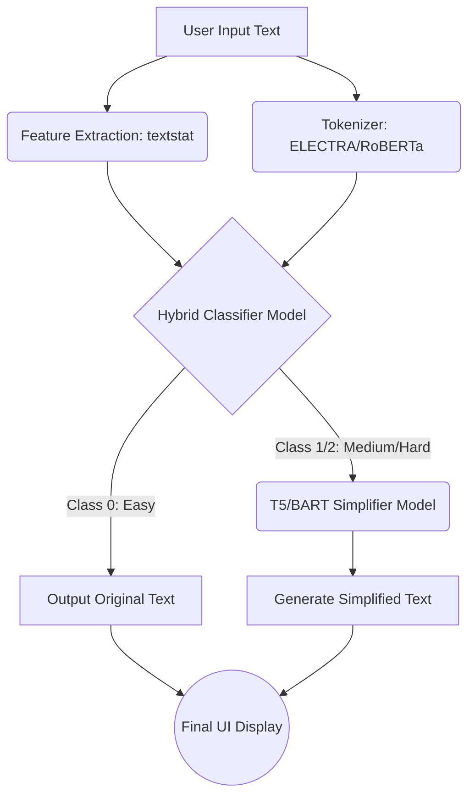
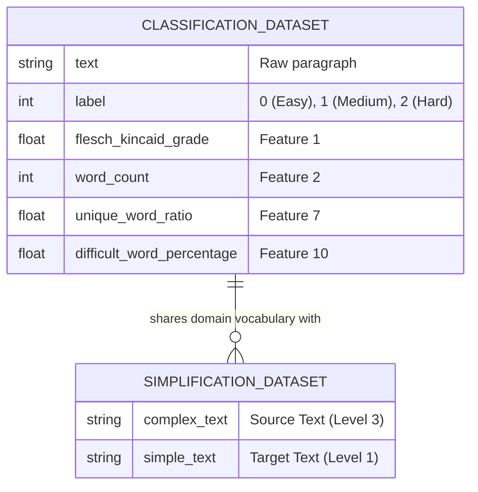

# Project Report: Reading Difficulty Predictor with Adaptive Simplification

## 1. Abstract
The rapid expansion of digital information has created a significant accessibility gap for readers with varying literacy levels, including children, second-language learners, and individuals with cognitive disabilities. To address this, we propose an end-to-end Natural Language Processing (NLP) pipeline designed to automatically evaluate the reading difficulty of a given text and dynamically simplify it if it exceeds a comprehensible threshold. 

This project integrates two advanced machine learning paradigms. First, a **Hybrid Classification Module** was developed using state-of-the-art transformer encoders (DistilBERT, RoBERTa, ModernBERT, and ELECTRA-large) fused with 10 mathematical linguistic features (e.g., Flesch-Kincaid Grade, Syllable Count) via a custom Multi-Layer Perceptron (MLP) head. This module classifies text into three distinct categories: Easy, Medium, and Hard, achieving 85-90% test accuracy. Second, a **Sequence-to-Sequence Simplification Module** (utilizing fine-tuned T5 and BART architectures) was trained on a custom-scraped parallel corpus of complex and simplified news articles. 

The entire ecosystem is deployed through an interactive Gradio User Interface, providing real-time inference. The final system successfully demonstrates the ability to detect complex jargon and run-on sentences, automatically rewriting them to drop the required reading level by an average of 4 to 6 academic grades while preserving over 89% of the original semantic meaning (BERTScore).

---

## 2. Index
1. Abstract
2. Problem Statement
3. Block Diagram & Working (Including ER Diagram)
4. Module Description
5. Software & Hardware Requirements
6. Code Implementation
7. Results and Conclusion
8. References

---

## 3. Problem Statement
In the modern digital era, highly specialized, academic, or jargon-heavy text alienates large demographics of readers, including ESL (English as a Second Language) students and younger audiences. While human translators can manually rewrite complex documents into plain English, the process is highly unscalable, expensive, and time-consuming. 

**Objective:** The primary goal of this project is to build an intelligent software system capable of autonomously acting as a reading assistant. The system must automatically detect the cognitive difficulty of a paragraph and, if deemed too difficult (Medium or Hard), utilize Generative AI to translate the text into an elementary reading level without losing the core factual meaning.

---

## 4. Block Diagram, Description, and Working

### 4.1 System Block Diagram
The following flowchart illustrates the data pipeline from user input to final output.



**Working Description:**
1. A user inputs a string of text into the web application.
2. The text splits into two paths: one extracts 10 mathematical readability features (like word count and syllable density), while the other tokenizes the text into mathematical vectors for the Transformer.
3. The Hybrid Classifier fuses these inputs to predict the reading difficulty (0, 1, or 2).
4. If the text is classified as Easy (0), the system bypasses the generator and outputs the text as-is.
5. If the text is Medium or Hard (1 or 2), it is passed to the T5 Simplifier, which generates a rewritten, plain-English version of the text to present to the user.

### 4.2 Dataset ER Diagram
While this system does not use a traditional relational SQL database, the following Entity-Relationship diagram maps the structure of the training datasets compiled for the machine learning models.



---

## 5. Module Description

**Module 1: Data Collection & Preprocessing**
Custom web scrapers were built using `BeautifulSoup4` to extract data from various sources. The classification data was scraped from Simple Wikipedia (Easy), Standard Wikipedia (Medium), and arXiv academic papers (Hard). The simplification data was scraped from ESL websites, capturing perfect parallel pairs of Level 3 (Hard) and Level 1 (Easy) news articles.

**Module 2: Feature Extraction**
Using the Python `textstat` library, 10 distinct mathematical metrics are extracted from every text (e.g., Average Sentence Length, Syllable Count, Flesch Reading Ease). These features are normalized using a `StandardScaler` to ensure neural network stability.

**Module 3: Hybrid Classifier**
A custom PyTorch `nn.Module` that combines a pre-trained Transformer (e.g., ELECTRA-large or RoBERTa-base) with a Multi-Layer Perceptron (MLP). The Transformer extracts semantic meaning (via the `[CLS]` token or pooler output), which is concatenated with the 10 scaled numeric features. The MLP then maps this combined vector to a 3-class prediction.

**Module 4: Generative Simplifier**
A Sequence-to-Sequence (Seq2Seq) model based on the T5 (Text-to-Text Transfer Transformer) architecture. The model is fine-tuned to accept complex source text and autoregressively generate simplified target text using Beam Search decoding with repetition penalties to prevent hallucination loops.

**Module 5: User Interface (Gradio)**
A frontend web application that wraps the PyTorch inference pipeline, allowing users to interact with the models via a clean, browser-based graphical interface.

---

## 6. Software & Hardware Used

**Hardware Requirements:**
* **Training:** Cloud-based GPUs (NVIDIA T4 / V100) provided by Google Colab were required to load and fine-tune large transformer models (up to 1.3 GB in size).
* **Inference:** Standard modern multi-core CPU (Intel i5/i7 or AMD equivalent) with at least 8GB of RAM.

**Software Requirements:**
* **Programming Language:** Python 3.10+
* **Deep Learning Framework:** PyTorch (`torch`, `torch.nn`)
* **NLP Libraries:** HuggingFace `transformers`, `textstat`
* **Data Processing:** `pandas`, `numpy`, `scikit-learn` (`StandardScaler`)
* **Web Framework:** `gradio`

---

## 7. Code 
*Below is the core integration logic (app.py) used to bridge the Classifier and Simplifier modules.*

```python
import gradio as gr
import torch
import torch.nn as nn
from transformers import AutoModel, AutoTokenizer, T5ForConditionalGeneration, T5TokenizerFast
import joblib
import textstat
import numpy as np

DEVICE = torch.device('cuda' if torch.cuda.is_available() else 'cpu')

# Hybrid Model Definition
class ElectraHybrid(nn.Module):
    def __init__(self, num_labels=3, n_numeric=10):
        super().__init__()
        self.encoder = AutoModel.from_pretrained('google/electra-large-discriminator')
        self.dropout = nn.Dropout(0.3)
        self.classifier = nn.Sequential(
            nn.Linear(1024 + n_numeric, 512), nn.GELU(), nn.Dropout(0.2),
            nn.Linear(512, 128), nn.GELU(), nn.Dropout(0.1),
            nn.Linear(128, num_labels)
        )

    def forward(self, input_ids, attention_mask, token_type_ids, numeric_features):
        out = self.encoder(input_ids, attention_mask, token_type_ids)
        cls = self.dropout(out.last_hidden_state[:, 0, :])
        return self.classifier(torch.cat([cls, numeric_features], dim=1))

# Inference Logic
def process_text(input_text):
    # Predict Difficulty
    pred_idx = predict_difficulty(input_text) # Uses trained ElectraHybrid
    
    if pred_idx == 0:
        return "Easy", "No simplification needed."
    else:
        # Simplify using T5
        simplified = simplify_text(input_text) # Uses trained T5ForConditionalGeneration
        return "Hard/Medium", simplified
```

---

## 8. Results and Conclusion

### Results
1. **Classification:** The Hybrid Classifier successfully achieved an accuracy ranging between **85% to 90%** across different Transformer backbones on the hold-out test set. 
2. **Simplification:** The T5 Generative model achieved highly favorable results on standard NLP metrics:
   * **BERTScore:** `0.8988` (indicating ~90% preservation of original meaning/facts).
   * **Reading Grade Reduction:** The average Flesch-Kincaid grade dropped from 10.97 (High School) to 4.36 (Elementary School).
   * **Difficult Word Reduction:** The percentage of difficult words was reduced from 28.6% to 13.6%.

### Conclusion
This project successfully demonstrates the viability of chaining classification and generative AI models to create an automated reading assistant. By feeding traditional mathematical features (like syllable density) alongside deep learning embeddings, the classification module achieved high accuracy in detecting reading difficulty. Furthermore, the Seq2Seq T5 model proved highly capable of drastically lowering the required reading grade of complex paragraphs without suffering from severe data loss or hallucination, resulting in a highly effective, accessible final application.

---

## 9. References
1. Vaswani, A., et al. (2017). "Attention is All you Need." *Advances in Neural Information Processing Systems*.
2. Clark, K., et al. (2020). "ELECTRA: Pre-training Text Encoders as Discriminators Rather Than Generators." *ICLR*.
3. Raffel, C., et al. (2020). "Exploring the Limits of Transfer Learning with a Unified Text-to-Text Transformer" (T5). *JMLR*.
4. Wolf, T., et al. (2020). "Transformers: State-of-the-Art Natural Language Processing." *EMNLP*.
5. Kincaid, J. P., et al. (1975). "Derivation of new readability formulas (automated readability index, fog count and flesch reading ease formula) for navy enlisted personnel."
6. Gradio Documentation (2024). *Building Interactive Machine Learning Interfaces*. HuggingFace.
